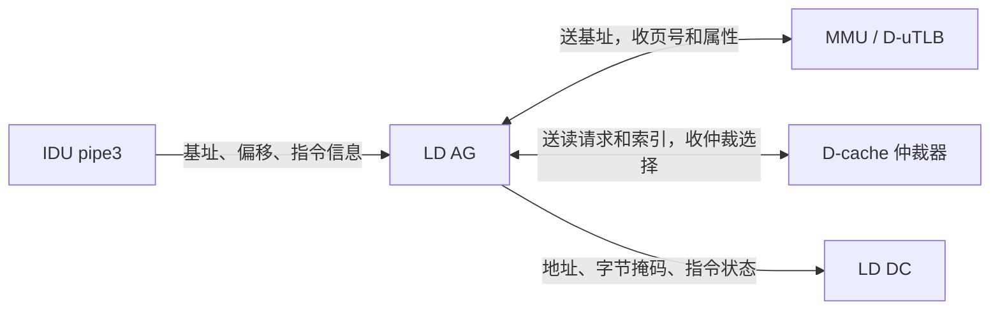

# C910 `ct_lsu_ld_ag` 代码导读

AG 是 load 流水线的地址生成级。IDU 的 pipe3 交来一条指令和它的操作数，AG 算出要访问的地址和字节范围，同时配合 MMU 查页、向 D-cache 发读请求。下一拍，DC 用 AG 送来的地址检查 D-cache 命中和 store 依赖，DA 再选择数据来源。读 AG 时，先看 `ld_ag_inst_vld` 确认本级有指令，再看 `ld_ag_dc_inst_vld` 确认这次能否交给 DC。[LSU 顶层 AG 实例](../ct_lsu_top.v#L2801) · [DC 判定缓存命中](../ct_lsu_ld_dc.v#L1622)

## 输入从哪来

下面表里的 `src0`、`offset` 等字段均带 `idu_lsu_rf_pipe3_` 前缀。`IID` 是指令编号，可用于比较程序顺序。`LSIQ` 是访存发射队列，`lch_entry` 用 12 位 one-hot（只有对应条目的一位为 1）标识是哪一项，重发时用这组位通知队列。[IDU pipe3 输出](../../../idu/rtl/ct_idu_rf_dp.v#L3011)

| 来源 | 输入 | AG 用它做什么 |
|---|---|---|
| IDU/RF | `sel`、`gateclk_sel` | `sel` 表示 RF 通过发射检查并向 AG 送指令。`gateclk_sel` 用于开本级数据时钟，也参与大部分数据寄存器的采样。 |
| IDU/RF | `src0[63:0]`、`offset[11:0]`、`offset_plus[12:0]`、`src1[63:0]`、`inst_ldr`、`off_0_extend`、`shift[3:0]` | `src0` 是基址。普通立即数 load 取 `offset`，寄存器偏移路径取 `src1`。跨 16 B 时还可能选用 IDU 预先算好的 `offset_plus`。 |
| IDU/RF | `inst_size[1:0]`、`inst_type[1:0]`、`atomic`、`inst_fls`、`unalign_2nd` | 决定访问大小、指令类型，以及这次是否处理跨界访问的第二段。 |
| IDU/RF | `iid[6:0]`、`lch_entry[11:0]`、`oldest`、`preg` / `vreg`、`sign_extend` 等 | 保存指令和队列身份、目的物理寄存器号、加载结果的扩展方式。`split`、`already_da`、断点等状态也随指令传递。 |
| MMU | `mmu_lsu_pa0[27:0]`、`mmu_lsu_pa0_vld`、`mmu_lsu_page_fault0`、`mmu_lsu_{ca,so,buf,sec,sh}0`、`mmu_lsu_stall0` | 返回物理页号和翻译状态，以及可缓存、强序、可缓冲、安全、共享等属性。 |
| D-cache 仲裁器 | `dcache_arb_ag_ld_sel`、`dcache_arb_ld_ag_borrow_addr_vld`、`dcache_arb_ld_ag_addr[39:0]` | 告诉 AG load 读口是否选到自己。MMU 的读控制器 MCIC 借用 load 流水线时，仲裁器也会提供借用地址。 |
| RTU / ST AG | `rtu_yy_xx_flush`、三路 `rtu_yy_xx_commit*` 及各自的 IID、`st_ag_iid` | flush 清掉 AG 的指令有效位。原子指令比较 commit IID。`st_ag_iid` 用于提前判断当前 load 是否比并行的 store 年轻。 |
| CP0 / 时钟与复位 | `cp0_lsu_dcache_en`、`cp0_lsu_mm`、`cp0_lsu_cb_aclr_dis`、`cp0_lsu_da_fwd_dis`、`ctrl_ld_clk`、`forever_cpuclk`、`cpurst_b` 等 | 控制 D-cache、普通 load 非对齐处理、跨界加速、提前前递等。`ctrl_ld_clk` 驱动指令有效位，数据寄存器用本级 `ld_ag_clk`。 |

## 输出交给谁

| 去向 | 主要输出 | 看波形时怎么理解 |
|---|---|---|
| MMU 的端口 0 | `lsu_mmu_va0[63:0]`、`lsu_mmu_va0_vld`、`lsu_mmu_id0[6:0]`、`lsu_mmu_abort0`、`lsu_mmu_st_inst0` | `va0` 接当前 `ld_ag_base`，`va0_vld` 跟随 AG 有效位。`abort0` 标记这次翻译尝试应撤销。`st_inst0` 在 AMO 的 load 路径上置位，MMU 据此检查写权限。 |
| D-cache 仲裁器 | `ag_dcache_arb_ld_tag_req`、`ag_dcache_arb_ld_tag_idx[8:0]`、`ag_dcache_arb_ld_data_req[7:0]`、`ag_dcache_arb_ld_data_{low,high}_idx[10:0]` 及门控使能 | tag 索引是 `PA[14:6]`。低组 data 索引是 `PA[14:4]`，高组同一个索引的最低位取反。8 位请求对应 8 个 data bank，每个 bank 宽 4 字节。 |
| LD DC | `ld_ag_dc_inst_vld`、`ld_ag_dc_addr0[39:0]`、`ld_ag_dc_bytes_vld[15:0]`、`ld_ag_dc_bytes_vld1[15:0]`、`ld_ag_dc_rot_sel[3:0]`、`ld_ag_dc_access_size[2:0]` | `inst_vld` 是正常指令流进入 DC 的有效信号。`addr0` 通常是 load 的 PA，MCIC 借用时选借用地址。字节掩码按 16 B 数据块编号，`rot_sel` 是原始地址低 4 位，供后级对齐数据。 |
| LD DC | `ld_ag_boundary`、`ld_ag_secd`、`ld_ag_dc_acclr_en`、`ld_ag_addr1_to4`、`ld_ag_vpn`、`ld_ag_page_*`、`ld_ag_utlb_miss`、`ld_ag_expt_*` 等 | 传递跨界和段号、拼接低地址段所需的地址信息、页属性、翻译缺失和异常。指令号、目的寄存器号等也一并传下去。`ld_ag_dc_mmu_req` 等于 `!lsu_mmu_abort0`，随指令下传，用于后级访问故障判断。 |
| IDU / LSU 控制 | `lsu_idu_ld_ag_wait_old[11:0]`、`ld_ag_stall_ori`、`ld_ag_stall_restart_entry[11:0]`、`lsu_idu_ag_pipe3_*` | `wait_old` 告诉 LSIQ 哪一项原子指令要等到最老。stall 与 entry 交给 `ct_lsu_ctrl` 生成重发唤醒。`pipe3_*` 带 load 的提前提示和目的寄存器号，供 IDU 判断依赖。 |
| Local Monitor / 性能计数 | `ld_ag_lm_init_vld`、`ld_ag_pa`、`lsu_hpcp_ld_{cross_4k,other}_stall` | 有效原子指令匹配当拍的 commit IID 时发出 monitor 初始化信号。HPCP 输出报告 AG 留拍相关事件。 |

带 `ld_ag_dc_` 前缀的 `load_inst_vld`、`load_ahead_inst_vld` 用于区分下游 load 路径和提前前递条件。判断 DC 是否收到这条指令，直接看 `ld_ag_dc_inst_vld`。[AG 下传条件](../ct_lsu_ld_ag.v#L1342) · [DC 锁存有效位](../ct_lsu_ld_dc.v#L916)

## 一条普通 `LW` 怎么走

1. **接住指令。** RF 给出 `sel` 后，AG 在时钟沿置有效位并保存这一条指令的信息。发生留拍时，指令有效位和身份可继续保留。`rtu_yy_xx_flush` 优先清掉有效位。[AG 流水寄存器](../ct_lsu_ld_ag.v#L582)
2. **算地址，同时查页。** `ld_ag_va_ori = ld_ag_base + ld_ag_offset_aftershift`。立即数 `offset` 按 12 位有符号数扩展。寄存器偏移路径选 `src1`，`off_0_extend` 可取其低 32 位并零扩展，`shift` 的四位分别允许左移 0、1、2、3 位。MMU 同拍从 `lsu_mmu_va0` 收到基址，AG 用返回的物理页号拼上所选 `ld_ag_va[11:0]` 得到 `ld_ag_pa`。若地址加法跨过 4 KiB 页，AG 会先更新基址，再送正确的页去翻译。[偏移选择](../ct_lsu_ld_ag.v#L728) · [虚拟地址加法](../ct_lsu_ld_ag.v#L789) · [MMU 与物理地址拼接](../ct_lsu_ld_ag.v#L1035)
3. **选字节和 bank。** `inst_size` 编码 `00/01/10/11` 分别代表 1/2/4/8 B。块内起点是 `ld_ag_va_ori[3:0]`，终点是 `起点 + (字节数 − 1)`。每个掩码位对应块内的一个字节。AG 有有效指令且 D-cache 启用时就发 tag 请求，data 请求再用 bank 掩码选择。D-cache 仲裁决定谁读阵列，DC 根据 tag、valid 和页属性判断命中。[访问大小](../ct_lsu_ld_ag.v#L839) · [边界计算](../ct_lsu_ld_ag.v#L902) · [D-cache 读请求](../ct_lsu_ld_ag.v#L1124) · [DC 命中判断](../ct_lsu_ld_dc.v#L1622)

以 `lw x5, 4(x6)` 为例，设 `x6 = 0x1000`、MMU 返回物理页号 `0x12345`、D-cache 启用且本次获准。AG 送 `0x1000` 给 MMU，自己算出 `VA = 0x1004`，拼出 `PA = 0x12345004`。访问块内字节 4～7，所以 `ld_ag_dc_bytes_vld = 16'h00F0`、`ld_ag_dc_rot_sel = 4'h4`。两个 bank 组各选组内编号 1，`ag_dcache_arb_ld_data_req = 8'h22`。

## 跨 16 B 与跨 4 KiB

自然对齐看访问大小，例如 4 B 的 `LW` 要求起始地址能被 4 整除。跨 16 B 看需要从几个数据块取字节，跨 4 KiB 看地址计算是否需要换页。

**跨 16 B 要分字节。** 例如 `ld x5, 14(x6)`，`x6 = 0x1000`，在允许普通 load 非对齐、页面可缓存的情况下，要取 `0x100E～0x1015` 共 8 B。`0x100E` 的块内起点是 14，`14 + (8 − 1) = 21`，所以跨了 16 B。对这个立即数 load，IDU 提前算出的 `offset_plus` 是 `14 + 16`。AG 在首段选 `base + offset_plus`，高地址段先进入流水线。[IDU 生成 `offset_plus`](../../../idu/rtl/ct_idu_rf_pipe3_decd.v#L724) · [AG 选首段地址](../ct_lsu_ld_ag.v#L794) · [AG 选字节掩码](../ct_lsu_ld_ag.v#L977)

| 执行顺序 | `ld_ag_secd` | AG 本次选择的 `ld_ag_va` | 这段真正需要的字节 | `ld_ag_dc_bytes_vld` |
|---|---:|---|---|---|
| 首段，高地址块 | 0 | `0x101E` | `0x1010～0x1015` | `16'h003F`，块内 0～5 |
| 第二段，低地址块 | 1 | `0x100E` | `0x100E～0x100F` | `16'hC000`，块内 14～15 |

`0x101E` 定位高地址块，块内实际选哪几个字节看 `bytes_vld`。首段同时带出低地址块的 `bytes_vld1 = 16'hC000` 和 `ld_ag_addr1_to4 = ld_ag_va_ori[39:4]`。满足本级跨界加速条件时，`ld_ag_acclr_en` 先打开全部 8 个 bank。翻译结果有效且页面可缓存时，`ld_ag_dc_acclr_en` 再允许 DC/DA 尝试与 Cache Buffer 中的数据合并。[AG 加速条件](../ct_lsu_ld_ag.v#L1070) · [DC 生成低地址段 PA](../ct_lsu_ld_dc.v#L1323) · [DC 合并条件](../ct_lsu_ld_dc.v#L1767)

按两段走时，DA 在首段通过且需要第二段时通知 LSIQ。LSIQ 让同一条指令带 `unalign_2nd=1` 再发一次，AG 将它记为 `ld_ag_secd=1`。[DA 通知第二段](../ct_lsu_ld_da.v#L2576) · [LSIQ 保存段号](../../../idu/rtl/ct_idu_is_lsiq_entry.v#L1047)

**跨 4 KiB 要重查页。** 把同一条 `ld` 的基址改为 `0x1FF0`，访问范围变成 `0x1FFE～0x2005`。首次算出的高地址段代表地址是 `0x200E`，而 MMU 当前看到的基址仍在 `0x1xxx` 页。AG 拉高 `lsu_mmu_abort0`，这拍停在 AG。若这条指令保留在 AG，下一拍 `ld_ag_base` 改为 `0x200E`、偏移清零，MMU 收到新页地址。此路径关掉跨界合并加速，低地址段重发时用它自己的页号。`ld_ag_cross_4k` 检查的是地址加法的跨页条件，因此 `base=0x1FF8`、`offset=12` 的对齐 `LW` 到 `0x2004` 时也会触发，虽然四个字节都在同一个 16 B 块内。[跨页检测](../ct_lsu_ld_ag.v#L1251) · [留拍时重写地址操作数](../ct_lsu_ld_ag.v#L694)

寄存器偏移的 `inst_ldr` 路径也有一次首段地址调整。首次发现跨 16 B 时先留拍，把算出的原始 VA 写回基址寄存器，再用 `+16` 得到高地址段的地址。[LDR 留拍条件](../ct_lsu_ld_ag.v#L1273) · [LDR 偏移改写](../ct_lsu_ld_ag.v#L741)

## 什么时候下传、留拍或重发

`ld_ag_dc_inst_vld = ld_ag_inst_vld && !ld_ag_stall_restart`。先看当前指令是否被这个条件拦住，再看它留在 AG 还是回 LSIQ。[AG 下传条件](../ct_lsu_ld_ag.v#L1298)

| 场景 | 这条指令怎么走 | 关键条件 |
|---|---|---|
| 跨页重算、LDR 首段调整、D-cache 没选 AG，或 `mmu_lsu_stall0=1` | 触发 AG 留拍判断。通常保留当前指令。若 RF 同拍送来更老的指令，则让它进入 AG，原 AG 指令回队列重发。 | `ld_ag_stall_ori` 给出原始留拍条件，`ld_ag_stall_vld` 表示本级实际保留。当前版本 D-uTLB 读口把 `mmu_lsu_stall0` 接为常 0。 |
| 原子指令（LR/AMO）尚无同 IID 的 commit 信号 | AG 阻止本次下传，通过 `lsu_idu_ld_ag_wait_old` 通知 LSIQ。该项成为队列里最老的一项时可解除这个等待。 | `ld_ag_atomic_no_cmit_restart_req`、`ld_ag_cmit`。匹配 commit 时 `ld_ag_lm_init_vld` 置 1。 |
| `mmu_lsu_pa0_vld=0`，本拍满足下传条件 | AG 把 `ld_ag_utlb_miss` 送给 DC。DC 对有效、无优先异常的 miss 根据 `mmu_lsu_tlb_busy` 选择立即重发或等 TLB 唤醒。 | `ld_ag_utlb_miss = !mmu_lsu_pa0_vld`、`ld_dc_utlb_miss_vld`。 |
| 检出非对齐或页故障，本拍满足下传条件 | 异常标志随指令进入 DC。例如禁止非对齐的普通 load，会置 `ld_ag_expt_misalign_no_page` 并同时撤销本次翻译。 | `ld_ag_expt_misalign_no_page`、`ld_ag_expt_misalign_with_page`、`ld_ag_expt_page_fault`。 |

AG 有原始留拍且 RF 同拍发来指令时，由 IID 比较决定谁重发。RF 更老，`ld_ag_stall_restart_entry` 选当前 AG 的 `ld_ag_lsid`。其余情况选 RF 的 `lch_entry`，当前 AG 指令继续留拍。`ct_lsu_ctrl` 用这组 one-hot 位产生相应的 LSIQ 唤醒。[AG 选择重发条目](../ct_lsu_ld_ag.v#L1310) · [LSU 产生重发唤醒](../ct_lsu_ctrl.v#L899) · [LSIQ 的 `wait_old`](../../../idu/rtl/ct_idu_is_lsiq_entry.v#L966) · [DC 区分 TLB 重发类型](../ct_lsu_ld_dc.v#L1449) · [D-uTLB 读口](../../../mmu/rtl/ct_mmu_dutlb_read.v#L444)

读异常时，按访问类型和页属性看条件。发现非对齐时，原子指令和 `cp0_lsu_mm=0` 下的普通 load 会报 `misalign_no_page`。若翻译返回强序属性，普通 load 的非对齐会触发 `misalign_with_page`。`mmu_lsu_pa0_vld=1` 时也要检查 `mmu_lsu_page_fault0`。AMO 访问不可缓存页的标志 `ld_ag_expt_ldamo_not_ca` 单独送进 DC，由 DA 并入访问故障判断。[AG 的异常生成](../ct_lsu_ld_ag.v#L1204) · [DC 的额外访问故障](../ct_lsu_ld_dc.v#L1214) · [DA 的访问故障合并](../ct_lsu_ld_da.v#L1540)

## 跟波形时先看这些信号

| 要确认的问题 | 信号顺序 |
|---|---|
| 这条指令现在在哪一级？ | `idu_lsu_rf_pipe3_sel` → `ld_ag_inst_vld` / `ld_ag_iid` → `ld_ag_dc_inst_vld` |
| MMU 查了哪一页，AG 拼出了什么地址？ | `ld_ag_base` / `lsu_mmu_va0` → `ld_ag_va_ori` / `ld_ag_va` → `mmu_lsu_pa0_vld` / `ld_ag_pa` |
| 这拍读哪些字节和 bank？ | `ld_ag_boundary` / `ld_ag_secd` → `ld_ag_dc_bytes_vld` / `ld_ag_dc_bytes_vld1` → `ag_dcache_arb_ld_data_req` |
| 指令为什么没有继续执行？ | `ld_ag_stall_ori` / `ld_ag_stall_vld` → `ld_ag_stall_restart_entry` 或 `lsu_idu_ld_ag_wait_old`。若已进 DC，再看 `ld_ag_utlb_miss` 下传后的重发条件及异常标志。 |

普通 load 从发射到写回的完整波形见 [Load 命中](lsu_idu_timing/load-hit.svg)，翻译等待见 [μTLB busy 后重发](lsu_idu_timing/load-tlb-busy.svg)，RF 与 AG 争抢见 [RF 发射遇到 AG 留拍](lsu_idu_timing/rf-launch-ag-stall.svg)。
