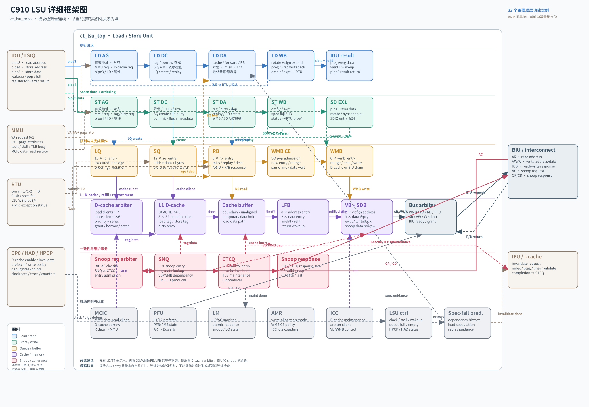

# C910 LSU 详细框架图

这份图按当前 `ct_lsu_top.v` 的实例化结构整理。图中的箭头是模块级聚合连线，标签只列出能帮助定位数据流的关键接口信号。逐根网线仍以 RTL 端口连接为准。

## 总览

## 图源

- [Mermaid 总览图源](lsu_architecture.mmd)
- [流水线与队列图源](lsu_pipeline.mmd)
- [D-cache、补行与总线路径图源](lsu_cache_path.mmd)
- [Snoop 与维护路径图源](lsu_coherence.mmd)
- [顶层实例与端口](../ct_lsu_top.v)

## 结构分层

| 层 | RTL 模块 | 主要职责 |
|---|---|---|
| Load pipeline | `ct_lsu_ld_ag` → `ct_lsu_ld_dc` → `ct_lsu_ld_da` → `ct_lsu_ld_wb` | 生成地址、翻译、查依赖与缓存、选择数据、写回 IDU |
| Store pipeline | `ct_lsu_st_ag` → `ct_lsu_st_dc` → `ct_lsu_st_da` → `ct_lsu_st_wb` | 生成地址、建立 SQ、完成检查、向 RTU 报告状态 |
| Store data | `ct_lsu_sd_ex1` | 接收 pipe5 写数据，按 SDIQ 标识写入 SQ |
| Ordering queues | `ct_lsu_lq`, `ct_lsu_sq` | LQ 记录已执行 load，SQ 配对 store 地址、数据和字节有效位 |
| Outstanding reads | `ct_lsu_rb`, `ct_lsu_lfb` | RB 跟踪未完成读，LFB 组织整 cache line 补入和返回唤醒 |
| Store drain | `ct_lsu_wmb_ce`, `ct_lsu_wmb` | SQ pop 后合并写操作，排出到 D-cache 或 BIU |
| Cache | `ct_lsu_dcache_arb`, `ct_lsu_dcache_top`, `ct_lsu_cache_buffer` | 统一 D-cache 访问，保存 tag、dirty、数据 bank，并处理边界数据 |
| Replacement | `ct_lsu_vb`, `ct_lsu_vb_sdb_data` | 暂存被替换 cache line 及其写回数据 |
| Coherence | `ct_lsu_snoop_req_arbiter`, `ct_lsu_snoop_snq`, `ct_lsu_snoop_ctcq`, `ct_lsu_snoop_resp` | 接收 BIU AC，处理普通 snoop 和维护事务，返回 CR/CD |
| Control/optimization | `ct_lsu_ctrl`, `ct_lsu_bus_arb`, `ct_lsu_pfu`, `ct_lsu_mcic`, `ct_lsu_lm`, `ct_lsu_amr`, `ct_lsu_icc`, `ct_lsu_spec_fail_predict` | 时钟和阻塞控制、总线仲裁、预取、MMU 数据读、原子监视、cache 维护和推测辅助 |

## 容量和实现细节

- 当前配置文件启用了 `DCACHE_64K`。D-cache 顶层暴露 8 个 32-bit load data bank，以及 load tag、store tag 和 dirty array 接口。
- `ct_lsu_lq.v` 实例化 16 个 `ct_lsu_lq_entry`，`ct_lsu_sq.v` 实例化 12 个 `ct_lsu_sq_entry`。
- `ct_lsu_rb.v`、`ct_lsu_wmb.v` 和 `ct_lsu_lfb.v` 分别包含 8 个 RB entry、8 个 WMB entry、8 个 LFB address entry，LFB data entry 为 2 个。
- VB 地址 entry 为 2 个，VB/SDB data entry 为 3 个。SNQ 和 CTCQ 各有 6 个 entry。
- D-cache arbiter 的 load 选择向量覆盖 LFB、VB、SNQ、ICC、WMB、MCIC、AG 七类客户。store 选择向量覆盖 LFB、VB、SNQ、ICC、WMB、AG 六类客户。
- `ct_lsu_bus_arb` 汇合 WMB、VB、RB 和 PFU 的 AR/AW/W 请求。BIU 的 R/B 返回再按 ID 或状态回到 RB、LFB、MCIC 和 LM。
- `ct_lsu_top.v` 中 VMB 接口输出被绑定为常量，图中只用虚线提示其保留接口，不把它当成当前已实例化的数据结构。

## 读写关键路径

### Load

`IDU pipe3 → LD AG → LD DC → LD DA → LD WB` 是主流水。LD DC 同时创建 LQ entry 并检查 SQ/WMB 依赖。LD DA 在 D-cache、SQ/WMB 前递、RB/LFB 返回和异常结果之间选择最终数据。发生 miss 或慢路径时由 RB 保存未完成操作，LFB 接收总线返回并重新唤醒路径。

AG 的端口、地址计算和重发算例见 [LD AG 代码导读](ld_ag_guide.md)。

### Store

Store 地址从 `IDU pipe4` 进入 `ST AG`，写数据从 `IDU pipe5` 进入 `SD EX1`。`ST DC` 创建 SQ entry，SQ 等待地址和数据配对。RTU commit 后，满足数据有效和顺序条件的 SQ entry 经 `WMB CE` 决定新建或合并 WMB entry。WMB 通过 D-cache arbiter 写 L1，或通过 bus arbiter 发出 BIU 写请求。

### Coherence and maintenance

BIU AC 进入 snoop request arbiter。普通一致性事务进入 SNQ，I-cache/TLB 维护事务进入 CTCQ。SNQ 可借用 D-cache tag/data、访问 VB/WMB 依赖，CTCQ 把失效和完成状态送往 IFU、MMU。两类事务最后由 snoop response 复用 CR/CD 返回 BIU。

## 常用 RTL 定位

- 顶层实例分组在 `ct_lsu_top.v` 的 AG/EX1、DC、DA、WB、Linefill/Victim、Snoop 和 Other modules 区段。
- D-cache 客户选择和 serial 访问在 `ct_lsu_dcache_arb.v`。
- BIU 读写出口选择在 `ct_lsu_bus_arb.v`。
- Store 从 SQ 到 WMB 的合并入口在 `ct_lsu_wmb_ce.v`，WMB entry 的读写状态机在 `ct_lsu_wmb_entry.v`。
