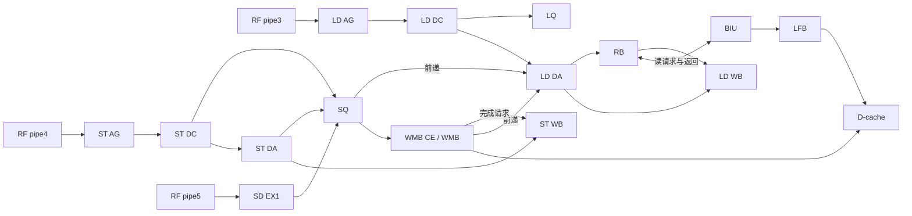

# C910 LSU 波形逐级导读

用 `make -C smart_run lsu-wave` 打开已跑完的用例。GTKWave 从约 34.174 µs 开始，默认展开 `Core 0 | Overview`。在中间信号栏双击分组名展开或收起，例如 `Load | AG`。`Time → Move To Time` 可以输入 `34235 ns` 这样的时间。A～E 对应下文的实测事件。[GTKWave 布局](../../../../../smart_run/tests/cases/lsu_smoke/lsu-stage.gtkw) · [仿真复现](lsu_smoke_sim.md)

先用 `*_sel` 或 `*_inst_vld` 找当前拍，再用 `*_iid` 跟同一条指令。看地址、数据和异常码时，用所在接口的有效位限定读数。`*_dc_inst_vld` 或 `*_da_inst_vld` 表示发往下一级的有效位，适合和本级的 `*_inst_vld` 对照。重发后同一 IID 会再次出现在 RF。`lch_entry` 是 LSIQ 发射队列的 one-hot 条目，`preg` 是物理目的寄存器号，store 地址与数据则用 SDIQ 条目或编码后的 `sdid` 配对。RF 的 `*_pc[14:0]` 是半字地址低 15 位，例如冷读显示 `0x44`，反汇编的字节 PC 为 `0x88`。完整退休 PC 看 `core0_pad_retire*_pc`。[IDU RF 端口](../../../idu/rtl/ct_idu_rf_dp.v#L3011) · [退休字节 PC](../../../rtu/rtl/ct_rtu_rob_rt.v#L2238)

## Load 逐级观察

| GTKWave 分组 | 这一级做什么 | 先看哪些信号 |
| --- | --- | --- |
| `Load \| RF (pipe3)` | IDU 读出操作数，通过 RF 级检查后把 load 发给 LSU。 | `idu_lsu_rf_pipe3_sel` 确认发射，接着看同前缀的 `iid`、`pc`、`src0`、`offset`、`inst_size`、`preg`。立即数路径用 `offset`，`inst_ldr=1` 时看寄存器偏移 `src1`。`gateclk_sel` 对照数据时钟使能。[IDU RF 控制](../../../idu/rtl/ct_idu_rf_ctrl.v#L1442) |
| `Load \| AG` | 计算 VA 和访问字节范围，用 MMU 端口 0 返回的物理页号拼出 PA，并发起 D-cache tag/data 读取。 | `ld_ag_inst_vld`、`ld_ag_iid` → `ld_ag_va`、`lsu_mmu_va0_vld`、`mmu_lsu_pa0_vld`、`mmu_lsu_pa0` → `ld_ag_dc_addr0`、`ld_ag_dc_bytes_vld`。`lsu_mmu_va0` 是送 MMU 的基址。`ag_dcache_arb_ld_tag_req` 和 `dcache_arb_ag_ld_sel` 成对看。停在 AG 时对照 `ld_ag_stall_vld` 和 `ld_ag_dc_inst_vld`。[LD AG 代码导读](ld_ag_guide.md) |
| `Load \| DC / LQ` | 对两路 D-cache tag 做比较，检查 SQ/WMB 的地址重叠与前递条件，符合条件时建 LQ 条目。 | `ld_dc_inst_vld`、`ld_dc_iid`、`ld_dc_addr0` → `ld_dc_hit_way0/1`。`ld_dc_lq_create_vld` 是建项请求，`lq_create_success` 表示实际分配。看不到 `ld_dc_da_inst_vld` 时查 `ld_dc_restart_vld`，再分辨 `ld_dc_utlb_miss_vld`、`ld_dc_lq_full_vld`、`ld_dc_depd_imme_restart_vld`。[命中判断](../ct_lsu_ld_dc.v#L1622) · [重发条件](../ct_lsu_ld_dc.v#L1444) · [LQ 建项](../ct_lsu_lq.v#L938) |
| `Load \| DA` | 按字节选择 D-cache 或 SQ/WMB 前递的数据，再做对齐。有数据时可请求 WB，慢路径可申请 RB。本级也处理异常、依赖和屏障等待。 | `ld_da_inst_vld`、`ld_da_iid`、`ld_da_addr` → `ld_da_dcache_hit` 与 `ld_da_fwd_sq_vld`、`ld_da_fwd_wmb_vld`。`ld_da_wb_data_req=1` 时读 `ld_da_wb_data`。`ld_da_data_vld=1` 仍可能遇到 `ld_da_wait_fence_req` 并重发。需要等总线时看 `ld_da_rb_create_vld`。[数据选择](../ct_lsu_ld_da.v#L1821) · [重发条件](../ct_lsu_ld_da.v#L2199) · [WB 请求](../ct_lsu_ld_da.v#L2419) |
| `Load \| RB / BIU / LFB` | RB 保留待完成的 load，向 BIU 请求读取，并把所需数据交给 WB。可缓存 miss 同时由 LFB 收集整条 cache line，仲裁写回 D-cache。 | `rb_create_ld_success` → `rb_biu_ar_req` → `lsu_biu_ar_req`、`biu_lsu_ar_ready`、`lsu_biu_ar_addr/id`。用返回 `biu_lsu_r_vld/id/last` 确认对应事务。看 `rb_ld_wb_data_req/iid/data` 跟本条 load 的数据，另看 `lfb_dcache_arb_ld_req`、`lfb_dcache_arb_ld_tag_req` 和 `dcache_arb_lfb_ld_grnt` 跟回填。[RB 返回数据](../ct_lsu_rb.v#L2727) · [LFB 回填](../ct_lsu_lfb.v#L1705) |
| `Load \| WB` | 仲裁 DA、RB 等来源。RTU 的指令完成通路和 IDU 的目的寄存器写回通路分别产生有效位。 | 用 `ld_wb_da_data_grnt` / `ld_wb_rb_data_grnt` 识别数据来源。`lsu_idu_wb_pipe3_wb_preg_vld=1` 时看 `ld_wb_data_iid`、`lsu_idu_wb_pipe3_wb_preg` 和 `lsu_idu_wb_pipe3_wb_preg_data`。RTU 完成单独看 `lsu_rtu_wb_pipe3_cmplt/iid/expt_vld`。[WB 数据仲裁](../ct_lsu_ld_wb.v#L549) · [完成与写回端口](../ct_lsu_ld_wb.v#L1081) |

## Store 逐级观察

| GTKWave 分组 | 这一级做什么 | 先看哪些信号 |
| --- | --- | --- |
| `Store \| RF (pipe4)` | IDU 发射 store 地址操作，也从 pipe4 送 `fence` 等访存控制指令。 | `idu_lsu_rf_pipe4_sel` 置位后读同前缀的 `iid`、`pc`、`staddr`、`sync_fence`。追普通 store 时还看 `src0`、`offset` 和 `sdiq_entry`。本次 `sd` 的 `staddr=1`、`sync_fence=0`。[RF 发射](../../../idu/rtl/ct_idu_rf_ctrl.v#L1448) · [Pipe4 操作数](../../../idu/rtl/ct_idu_rf_dp.v#L3268) |
| `Store \| AG` | 算 store 的 VA、PA、字节掩码，用 MMU 端口 1 查页并发起 D-cache tag/dirty 读取。 | `st_ag_inst_vld`、`st_ag_iid`、`st_ag_va` → `lsu_mmu_va1_vld`、`mmu_lsu_pa1_vld`、`mmu_lsu_pa1` → `st_ag_dc_addr0`、`st_ag_dc_bytes_vld`。看 `ag_dcache_arb_st_tag_req` 和 `dcache_arb_ag_st_sel`，再看 `st_ag_dc_inst_vld` 是否下传。[MMU 端口 1](../ct_lsu_st_ag.v#L1054) · [AG 下传](../ct_lsu_st_ag.v#L1374) |
| `Store \| DC` | 比较 tag，生成送 ST DA 的缓存信息，为需要的操作申请 SQ；可把地址就绪和 SDIQ 条目反馈给 IDU。 | `st_dc_inst_vld`、`st_dc_iid`、`st_dc_addr0`、`st_dc_bytes_vld` → `st_dc_sq_create_vld`。用 `st_dc_sdid`、`lsu_idu_dc_staddr_vld`、`lsu_idu_dc_sdiq_entry` 关联数据路径。当 `st_dc_da_inst_vld` 为 0 时，对照 `st_dc_utlb_miss_vld`、`st_dc_sq_full_vld` 和 `st_dc_restart_vld`。[SQ 请求](../ct_lsu_st_dc.v#L1045) · [地址就绪反馈](../ct_lsu_st_dc.v#L1225) |
| `Store \| DA` | 汇总 tag/dirty 和异常结果，更新相同 IID 的 SQ 条目。满足条件的普通 store 向 ST WB 报告完成。 | `st_da_inst_vld`、`st_da_iid`、`st_da_addr`，再看 `st_da_st_inst`、`st_da_fence_inst`、`st_da_dcache_hit`。用 `st_da_sq_no_restart` 看 SQ 可接收的执行结果，用 `st_da_wb_cmplt_req` 看 DA 提交给 WB 的完成请求。[操作类型](../ct_lsu_st_da.v#L1052) · [SQ 更新](../ct_lsu_sq_entry.v#L1082) · [完成请求](../ct_lsu_st_da.v#L1476) |
| `Store \| RF (pipe5) / SD EX1` | IDU 经独立的 pipe5 发 store 数据。SD EX1 保存并选择写数据，SQ 根据 SDID 找目标条目。 | `idu_lsu_rf_pipe5_sel`、`idu_lsu_rf_pipe5_src0`、`idu_lsu_rf_pipe5_sdiq_entry` → `sd_rf_ex1_sdid` → `sd_ex1_inst_vld`、`sd_ex1_data`。`sd_rf_ex1_sdid` 在 RF 当拍读，`lsu_idu_ex1_sdiq_entry` 是到 EX1 后的 one-hot 条目。[SDID 编码](../ct_lsu_sd_ex1.v#L188) · [EX1 数据选择](../ct_lsu_sd_ex1.v#L269) |
| `Store \| SQ` | 保存地址、字节掩码、数据和提交状态。地址和数据可分拍到达。条目满足顺序、commit、数据有效和执行完成条件后才能进入 WMB CE。 | 用 `sq_create_success`、`sq_create_ptr` 找建项。看 `sq_entry_cmit`、`sq_pop_ptr`、`sq_pop_addr`、`sq_wmb_pop_to_ce_req` 和 `wmb_sq_pop_to_ce_grnt`。本次 `sd` 用 entry 0，组内 `sq_entry_sdid`、`sq_entry_data_set`、`sq_entry_data_vld` 可直接对照。其它条目在 `x_ct_lsu_sq_entry_N`。[数据配对](../ct_lsu_sq_entry.v#L1094) · [SQ 出队条件](../ct_lsu_sq_entry.v#L1240) |
| `Store \| WMB` | WMB CE 接收 SQ 出队的操作，建立或合并 WMB 条目。WMB 可给后续 load 前递，也会经仲裁更新 D-cache 或走 BIU 写路径。 | 用 `wmb_ce_vld`、`wmb_ce_iid`、`wmb_ce_addr` 跟 CE 条目，接着看 `wmb_ce_create_wmb_req` / `wmb_ce_merge_wmb_req`。前递看 `wmb_ld_dc_fwd_req` 和 `wmb_fwd_bytes_vld`。写 cache 看 `wmb_write_req_addr`、`wmb_write_dcache_bytes_vld`、`wmb_dcache_arb_ld_req`、`dcache_arb_wmb_ld_grnt` 和 `wmb_write_dcache_success`。[CE 建项](../ct_lsu_wmb_ce.v#L483) · [写 D-cache](../ct_lsu_wmb.v#L4243) |
| `Store \| WB` | 从 ST DA 或 WMB 收完成或异常，向 RTU 的 pipe4 汇报。普通 cacheable `sd` 的完成可以早于 WMB 写 D-cache。 | `st_da_wb_cmplt_req` 或 `wmb_st_wb_cmplt_req` → `lsu_rtu_wb_pipe4_cmplt`、`lsu_rtu_wb_pipe4_iid`。`lsu_rtu_wb_pipe4_expt_vld=1` 时再读异常码。[ST WB 仲裁](../ct_lsu_st_wb.v#L174) · [RTU 端口](../ct_lsu_st_wb.v#L330) |

`Core 0 | Commit and retire` 中用三路 `rtu_yy_xx_commit*` 及各路 `*_iid` 找提交给 LSU 的指令，再用 `core0_pad_retire*` 和对应的 `*_pc` 对反汇编。发生流水线清除时看 `rtu_yy_xx_flush`。[RTU commit 信号](../../../rtu/rtl/ct_rtu_rob_rt.v#L2723) · [用例反汇编](../../../../../smart_run/work/lsu-smoke-make/lsu_smoke.dis)

## 用这次 FST 跟两笔访问

时间均为 `ns`，对应信号在该拍的波形值。相邻 CPU 拍间隔为 10 ns。[FST 波形](../../../../../smart_run/work/lsu-smoke-make/lsu.fst) · [仿真日志](../../../../../smart_run/work/lsu-smoke-make/simulation.log)

### 冷读 `ld t3, 0(s0)`，PC `0x088`，IID `0x0B`

| 时间 | 打开分组并对照 |
| ---: | --- |
| 34205 | **RF**。`sel=1`，`src0=0x40000`、`offset=0`、`inst_size=3`（8 B）、`preg=0x2A`。 |
| 34215 | **AG**。`ld_ag_iid=0x0B`，VA 和 PA 都为 `0x40000`，`ld_ag_dc_bytes_vld=0x00FF`，仲裁选中 AG 并下传。 |
| 34225 | **DC / LQ**。`ld_dc_da_inst_vld=1`，两个 way 都未命中。`ld_dc_old=1`，屏蔽了此条的 `ld_dc_lq_create_vld`。[LQ 建项条件](../ct_lsu_ld_dc.v#L1300) |
| **34235（A）** | **DA**。`ld_da_inst_vld=1`、`ld_da_dcache_hit=0`。`ld_da_rb_create_vld=1`，同时 `ld_da_wb_cmplt_req=1`、`ld_da_wb_data_req=0`。 |
| 34245 | **RB / BIU / LFB、WB**。`lsu_biu_ar_req=1`、`biu_lsu_ar_ready=1`，地址 `0x40000`、读 ID `0`。RTU 已见 `cmplt=1`，目的寄存器写回有效位仍为 0。 |
| 34655 → 34675 | **RB / BIU / LFB、WB**。34655 看到 ID `0` 的 R 返回。34665，`rb_ld_wb_data_req=1`、数据 IID 为 `0x0B`。34675 写回 `preg=0x2A`，值 `0x0123456789ABCDEF`。 |
| **34705（B）** | **RB / BIU / LFB**。`lfb_dcache_arb_ld_req=1`、`lfb_dcache_arb_ld_tag_req=1`，`dcache_arb_lfb_ld_grnt=1`。这拍是缓存行的 tag 回填，冷读所需数据已经写回。 |

A 后第一段 store 流水活动在 34265 ns 发射，34305 ns 的 `st_da_fence_inst=1`。它是 PC `0x094` 的 `fence rw,rw`。下一条 load（PC `0x100`、IID `0x19`）在 35075 ns 已 D-cache hit，但 `ld_da_wait_fence_req=1` 触发重发。**35185 ns（C）**，相同 IID 再到 DA，`ld_da_wait_fence_req=0`、`ld_da_wb_data_req=1`。35195 ns 写回 `0xFEDCBA9876543210`。

### `sd t2, 8(s1)` 加紧随的 `ld t5, 8(s1)`，PC `0x110` / `0x114`

| 时间 | 打开分组并对照 |
| ---: | --- |
| 35205 → 35215 | **Store RF (pipe4)、AG**。35205 发射 `sd`，IID 为 `0x1D`，基址 `0x40000`、偏移 `8`。同拍发射的 load IID 为 `0x1E`。35215，AG 得到地址 `0x40008`、掩码 `0xFF00`。 |
| 35225 | **Store DC、SQ、RF (pipe5) / SD EX1**。`sq_create_success=1`、`sq_create_ptr=0x001`，地址条目 SDID 为 `0`。pipe5 发出 `0x13579BDF2468ACE0`，one-hot `sdiq_entry=0x001`、编码 `sd_rf_ex1_sdid=0`。同一拍年轻 load 在 LD DC 命中并行 store 依赖，`ld_dc_depd_imme_restart_vld=1`，这次 `ld_dc_da_inst_vld=0`。 |
| 35235 | **Store DA、SQ、SD EX1**。`st_da_st_inst=1`、`st_da_fence_inst=0`，DA 报告可完成。`sd_ex1_inst_vld=1`，SQ entry 0 的 `sq_entry_data_set=1`。 |
| 35245 → 35255 | **Store WB、SQ、WMB**。35245 的 pipe4 `cmplt` 和 RTU commit 命中 IID `0x1D`。SQ 数据有效，请求和授权送 CE。35255，`wmb_ce_vld=1`、`wmb_ce_iid=0x1D`，为 `0x40008` 请求建立 WMB 条目。 |
| 35265 → **35275（D）** | **Load DC / LQ、DA**。重发的 `0x1E` 在 DC 看见 `wmb_ld_dc_fwd_req=1`、掩码 `0xFF00`。DA 同时有 `ld_da_dcache_hit=1` 和 `ld_da_fwd_wmb_vld=1`，对照 `ld_da_wb_data` 可见写回请求带的是 WMB 转发的新值。 |
| 35285 | **Store WMB、Load WB**。WMB 获仲裁，`wmb_write_dcache_success=1`，以 `0xFF00` 更新 `0x40008` 对应的字节。load `0x1E` 同拍写回 `0x13579BDF2468ACE0`。 |
| **35595（E）** | **Load WB**。第二条 `fence` 后，PC `0x120` 的 load（IID `0x21`）重发完成，从 D-cache 读回同一个新值。35615 ns，退休槽 1 的 PC 为 `0x128`。 |

本次 FST 覆盖对齐的 8 B 访存和 `fence`。μTLB busy、队列满和跨 16 B 的触发条件可结合 RTL 与已有时序示意阅读。[μTLB busy](lsu_idu_timing/load-tlb-busy.svg) · [LQ full](lsu_idu_timing/load-lq-full.svg) · [Store 跨 16 B](lsu_idu_timing/store-cross-16b.svg)
